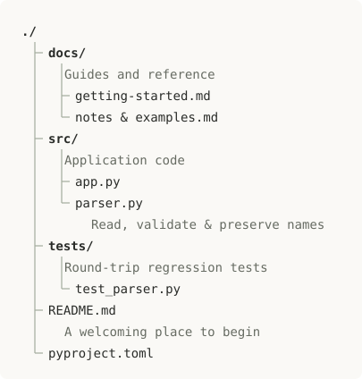

# Treestamp SVG rendering check

A transparent directory tree with monochrome text, connected branches, and inline `#` annotations. The README selects white ink for dark mode and black ink for light mode. Both SVGs contain the same editable treestamp metadata.

<picture>
  <source media="(prefers-color-scheme: dark)" srcset="assets/treestamp-dark.svg">
  <source media="(prefers-color-scheme: light)" srcset="assets/treestamp-light.svg">
  
</picture>

## What to check

- The image blends into the README background with no opaque panel.
- Switch GitHub between light and dark mode: names and annotations remain visible.
- Notes appear beside their entries, prefixed with `#`, rather than on nested rows.
- Branches connect, text is readable, and nothing is clipped.
- The ampersands in `notes & examples.md` and the parser annotation appear normally.

Inspect the individual files: [black ink / light appearance](assets/treestamp-light.svg) and [white ink / dark appearance](assets/treestamp-dark.svg). Each file has fixed ink; the README markup chooses which file to display.

## Relative-path markup

```html
<picture>
  <source media="(prefers-color-scheme: dark)" srcset="assets/treestamp-dark.svg">
  <source media="(prefers-color-scheme: light)" srcset="assets/treestamp-light.svg">
  
</picture>
```

This follows [GitHub's documented theme-aware image pattern](https://docs.github.com/en/get-started/writing-on-github/getting-started-with-writing-and-formatting-on-github/quickstart-for-writing-on-github#adding-an-image-to-suit-your-visitors). Paths are relative to the README. A single fixed appearance also works with ordinary Markdown image syntax.

The directories drawn inside the image are illustrative; this repository only needs the README and the two SVG assets.
